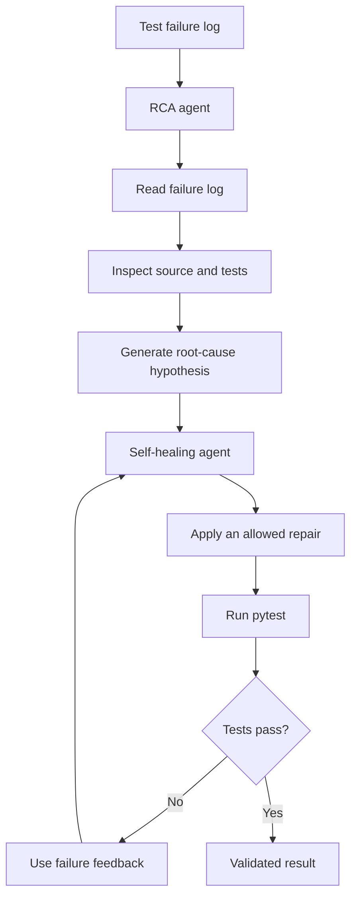

# Local AI RCA & Self-Healing Agent

A local-first experiment in AI-assisted debugging: investigate Python test failures, gather evidence from source code, propose a targeted repair, and validate the change with automated tests.

The project uses Ollama to run a local language model and Python tools to give the agent controlled access to test output, source files, and test execution.

## Why this project?

Debugging CI failures often requires engineers to move between build logs, stack traces, source code, and test results. This project explores how an AI agent can help automate that investigation loop while keeping validation grounded in executable tests.

The goal is not to let an LLM blindly rewrite code. It is to combine model-driven reasoning with explicit tools, bounded execution, and test-based feedback.

## Architecture



## Current capabilities

- **Local model execution:** uses Ollama with `qwen3:8b` by default.
- **Tool-based investigation:** reads failure output and relevant source/test files instead of relying only on a prompt.
- **Root-cause analysis:** uses test failures and code context to form a diagnosis.
- **Bounded repair loop:** limits agent steps and repair/test attempts.
- **Constrained file access:** restricts automatic edits to an allowlist of project files.
- **Automated validation:** runs pytest after a proposed code change.
- **Evidence-driven iteration:** uses subsequent test results to inform the next action.

## Repository layout

```text
local-ai-rca/
├── rca_agent.py              # Root-cause analysis agent
├── self_heal_agent.py        # Repair and validation loop
├── sample_app/
│   ├── calculator.py         # Example application under test
│   └── test_calculator.py    # Regression tests
├── .gitignore
└── README.md
```

## Prerequisites

- Python 3.10 or newer
- [Ollama](https://ollama.com/) installed and running
- A model compatible with Ollama; this project is currently configured for `qwen3:8b`
- macOS, Linux, or another environment that supports the dependencies

The model runs locally, so an external hosted LLM API is not required for the default workflow.

## Setup

Clone the repository and enter the project directory:

```bash
git clone https://github.com/chaitasipatel25/local-ai-rca.git
cd local-ai-rca
```

Create and activate a virtual environment:

```bash
python3 -m venv .venv
source .venv/bin/activate
```

Install the Python dependencies:

```bash
python -m pip install --upgrade pip
python -m pip install ollama pytest
```

Pull the model:

```bash
ollama pull qwen3:8b
```

Verify that Ollama can access the model:

```bash
ollama run qwen3:8b
```

At the model prompt, try a simple question, then exit with `/bye`.

## Run the tests

From the repository root:

```bash
python -m pytest -v sample_app
```

The sample suite covers totals without a discount, totals with a discount, and percentage-based discounts.

## Run the agents

Generate or provide a failure log that corresponds to a reproducible test failure before running an investigation. The agents use this evidence as input.

Run root-cause analysis:

```bash
python rca_agent.py
```

Run the self-healing workflow:

```bash
python self_heal_agent.py
```

Review the source changes and test results after each run. Do not treat a model-generated diagnosis or patch as correct merely because it sounds plausible.

## Design principles

1. **Evidence before conclusions:** inspect the failing test output and relevant source code before diagnosing a failure.
2. **Tests as a feedback loop:** use executable tests to evaluate a repair rather than relying on the model's confidence.
3. **Bounded autonomy:** cap tool calls, repair attempts, and test executions.
4. **Least privilege:** limit which files the agent can modify and which commands it can execute.
5. **Human review:** inspect proposed changes before accepting them into a real codebase.

## Current limitations

This is an evolving prototype, not a production-ready autonomous repair system.

- The sample application is intentionally small and does not represent the complexity of a large CI/CD environment.
- Local model output can be incorrect, incomplete, or inconsistent.
- Passing tests do not prove that a change is correct or preserves every intended behavior.
- Conflicting or incomplete requirements can lead to a patch that fixes one test while breaking another.
- Tool restrictions reduce risk but do not replace operating-system isolation or a proper sandbox.
- A production implementation would need stronger patch validation, structured agent traces, audit logs, timeouts, rollback, broader regression coverage, and explicit approval controls.

## Roadmap

- [ ] Add automated unit tests for agent tools and execution limits.
- [ ] Add structured root-cause reports with supporting evidence.
- [ ] Generate reviewable diffs instead of directly overwriting source files.
- [ ] Add regression checks for fixes that break previously passing tests.
- [ ] Add structured logs, run summaries, and repair-loop metrics.
- [ ] Evaluate diagnosis and repair quality against a repeatable failure corpus.
- [ ] Explore integration with CI pipelines and developer workflows.

## About

Built by [Chaitasi Patel](https://github.com/chaitasipatel25) to explore local LLM agents, automated root-cause analysis, and safer AI-assisted developer workflows.
